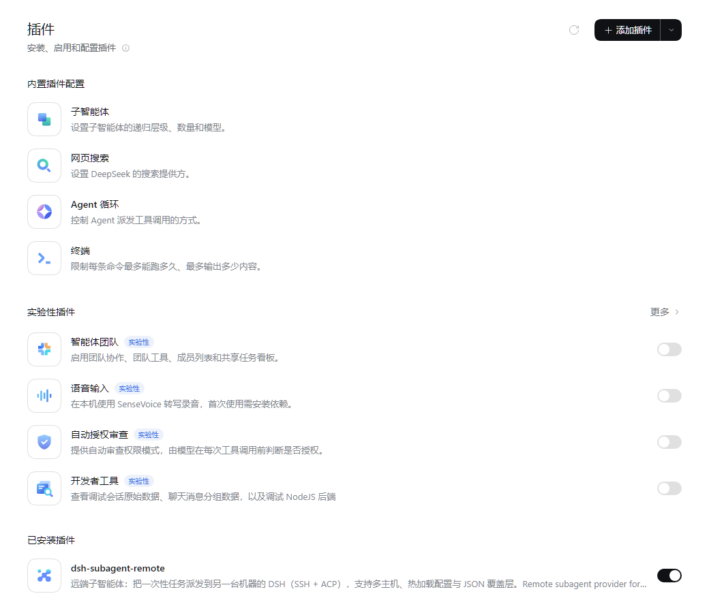
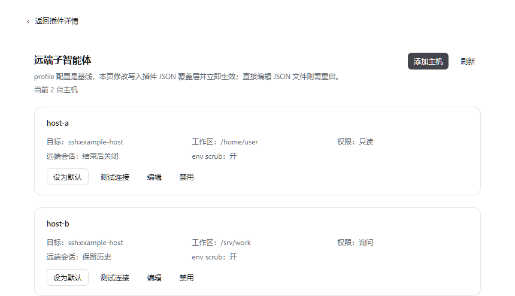
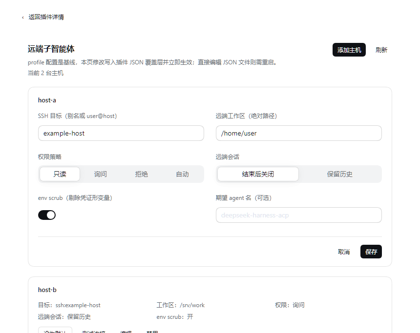

# Remote Subagent (`dsh-subagent-remote`)


[中文](README.zh.md) | English

[](https://www.npmjs.com/package/dsh-subagent-remote)
[](LICENSE)
[](package.json)

Cross-machine (remote) subagent provider for DeepSeek Harness (DSH). A delegation
issued from a local DSH session runs one **one-shot** subagent task on a DSH `acp`
profile living on another machine, over SSH, and returns that remote agent's
closing message to the local parent session.

> **Version status.** The repository is at `0.9.2-rc.8` (session-header run
> indicator + Windows remote + **visible unsettled runs**); `0.9.2-rc.8` is
> **not published to npm yet** — the registry builds are `0.9.2-rc.3` and
> `0.9.2-rc.4` (`latest`/`next` both point at `0.9.2-rc.4`). To use the current
> code, install from a checkout with `link:` or from a locally built bundle.
> Compatibility window: `engines.dsh: ">=0.2.0-rc.2 <0.3.0"`, `engines.node: ">=22"`.
> Verified on DSH `0.2.1-rc.5` (Windows desktop parent → a Linux host, a macOS host,
> and a local `acp` profile) and DSH `0.2.2-rc.1` (macOS parent → Windows remote;
> Web UI indicator running → done).

## Contents

- [Requirements](#requirements)
- [Screenshots](#screenshots)
- [Capabilities](#capabilities)
- [Installation forms](#installation-forms)
  - [npm registry](#npm-registry)
  - [Plugins page (Web/Desktop)](#plugins-page-webdesktop)
  - [Bundle install](#bundle-install)
  - [Local checkout (`link:`)](#local-checkout-link)
  - [Activation conditions](#activation-conditions)
  - [Path-loaded overlay](#path-loaded-overlay)
- [Files](#files)
- [How it works](#how-it-works)
- [Configuration](#configuration)
- [Permission model](#permission-model)
- [Failure behavior](#failure-behavior)
- [Diagnostics](#diagnostics)
- [Security & boundaries](#security--boundaries)
- [Development & verification](#development--verification)
- [Install / uninstall / rollback](#install--uninstall--rollback)
- [Known limits (V1/V2)](#known-limits-v1v2)
- [Compatibility](#compatibility)
- [License](#license)

## Requirements

| Side | Requirement |
|---|---|
| Local Host | DSH `>=0.2.0-rc.2 <0.3.0` (desktop app or a `dsh` CLI profile); Node `>=22` |
| Local UI *(optional)* | Web/Desktop for the plugin page, the session-header indicator and `/remote-host`; headless/ACP profiles keep dispatch, diagnostics and results without UI |
| Remote machine | its own DSH installation exposing the `acp` profile, reachable over SSH with a key/agent the local machine can use; POSIX `sh` or Windows OpenSSH (`cmd.exe` carrier) |
| Remote workspace | `cwd` must be an existing **absolute** path on the remote machine |

The plugin has no third-party runtime dependencies (`index.js` + `lib/*`, Node
built-ins only). SSH credentials are never stored by the plugin — they follow your
local `ssh` config/agent; remote DSH credentials stay on the remote machine.

## Screenshots

| Plugins page (installed plugin) | Configuration page | Host editor |
|---|---|---|
|  |  |  |

## Capabilities

- **Cross-machine one-shot delegation** — a local DSH session delegates a
  self-contained task to another machine's own DSH runtime (its tools, workspace,
  model and credentials); only the remote closing message comes back. Nothing about
  the local session is migrated or exposed over the network.
- **Windows remote** — when the host `cwd` is a drive-letter path (e.g.
  `C:/Users/me/work`) the plugin automatically uses a `cmd.exe` carrier: the remote
  command goes straight to Windows OpenSSH's `cmd.exe`, so no Git Bash is required
  on the target. The POSIX pid probe is unavailable on that carrier, so remote
  reaping becomes best-effort (ACP itself does not depend on the pid).
- **Unified multi-host tool** — one model-facing `remote_subagent` tool with a
  `host` argument; adding a machine is a configuration change, not a new tool row.
  An explicit legacy mode (`@deepseek-ai/dsh-tool-subagent` per host) is also
  supported.
- **Fail-closed permission policy** — `read-only` (default heuristic), `ask`
  (one in-turn run-scoped approval at dispatch), `deny`, `auto`. With no answer, a
  risky remote tool call is refused, never allowed.
- **Configuration page with hot reload** — the Plugins page lists hosts, probes SSH
  connectivity, edits field overrides and sets/clears the default host; page writes
  are persisted in a JSON overlay (a delta on the profile patch) and applied
  immediately — no restart for page edits.
- **Conversational host switching** — `/remote-host` lists hosts and switches the
  current session's target host.
- **Session-header run indicator** — after a dispatch, the conversation header shows
  the remote host, status and elapsed time (after the official subagent/background
  indicators); settled runs keep a short result/tool summary that expands into detail.
- **Automatic delegation hint (system prompt)** — every new session gets a dynamic
  system-prompt section describing the remote hosts and when to use them, so the model
  can choose `remote_subagent` without the user naming the plugin or tool. A plugin-page
  switch can turn the injection off (the tool remains available for manual reminders).
- **Visible unsettled runs (P0)** — a run still in-flight when the local Host restarts is
  recovered as `orphaned` (not failed) and shown in the plugin page and header with host,
  time and remote session id for manual reconciliation; never silently dropped. No
  automatic retry/resume yet.
- **Structured diagnostics** — fixed failure facts (`stage=`/`category=`), canned
  hints, permission decisions, `agent=`, env-scrub and peer-exit facts; raw remote
  text stays debug-gated.
- **Zero-dependency ESM Cordis plugin** — `index.js` plus `lib/*`; no third-party
  dependencies, and the whole package is dependency-free to test offline.

## Installation forms

All forms mount the same DSH **bundle**: `cordis.patch.yml` inserts one
`subagent-remote` row with no hosts, so a fresh install can never point at a wrong
machine. None of them stores SSH credentials (those follow your local `ssh`
config/agent).

### npm registry

Install a published build into a profile (`dsh plugin` forwards to `pnpm` inside
the profile directory, so any pnpm spec works):

```bash
dsh plugin --profile <profile> add dsh-subagent-remote
# pin a specific published build
dsh plugin --profile <profile> add dsh-subagent-remote@0.9.2-rc.4
```

Published builds are pre-releases: `0.9.2-rc.3` and `0.9.2-rc.4` are on npm
(`latest`/`next` both point at `0.9.2-rc.4`); the publish workflow maps `-rc.N`
versions to the `next` dist-tag and only final releases to `latest`. The current
repository version `0.9.2-rc.8` is **not published** — use `link:` or a local
bundle (below) to run it.

### Plugins page (Web/Desktop)

**Recommended on desktop/Web.** Open **插件 → 添加插件**, enter
`dsh-subagent-remote` and confirm. The plugin appears under **已安装插件**; open it
and use **打开配置**. The plugin card and configuration page are shown in the
screenshots above.

### Bundle install

The package is a DSH bundle (`dsh.bundle.patch` → `cordis.patch.yml`). Agent
tooling and non-UI flows can install it through the plugin manager's
`install_bundle` action with the package name/spec as `target` — the same action
the Plugins page uses. Use this form for a local build (for example a tarball
produced by `npm pack`) or a catalog/bundle spec. It inserts the patch into the
profile exactly like the CLI form; restart DSH afterwards.

### Local checkout (`link:`)

For development, link the checkout directly (the working tree is resolved as-is,
so `files` is irrelevant):

```bash
dsh plugin --profile <profile> add "link:/path/to/dsh-subagent-remote"
```

On Windows: `dsh plugin --profile <profile> add "link:C:\path\to\dsh-subagent-remote"`.

### Activation conditions

- Start the profile after installing: `dsh <profile> --port <n> --no-open`. The
  bundle patch inserts one row with no hosts; open **插件 → dsh-subagent-remote**
  (or **已安装插件 → dsh-subagent-remote → 打开配置**) and add the target machines.
- **Host half**: plugin code is loaded by the Host process — an install, an upgrade
  or any `index.js`/`lib/**` change needs a **DSH restart** (desktop app restart or
  profile process restart) to take effect.
- **Client bundle**: a `lib/client.js` change only needs a **Web page refresh**.
  `dsh.client` deliberately has **no `immediately: true`**: this is a
  configuration-page client, loaded lazily when the Plugins page/settings opens, so
  the normal chat boot path pays nothing. It still declares its web platform and all
  `inject` packages the bundle reads.
- **Headless / ACP deployments** have no `connection`/`commands` services: the
  plugin still loads and dispatch works; only the UI surfaces are absent.
- A fresh bundle install starts empty, so nothing is dispatched until you add and
  enable a host.
- The plugin row also works path-loaded from a profile patch (development workflow),
  but the configuration page only exists for bundle installs.

### Path-loaded overlay

The package can also be mounted directly from a checkout without a bundle install
(useful while iterating on the plugin itself). Point the insert row at this
folder's `index.js`; a relative `name` is resolved against the patch file:

```yaml
- insert:
    - id: subagent-remote
      name: ../path/to/dsh-subagent-remote/index.js
      config: { ... }
```

Then `dsh --profile headless --patch <patch> "…"`. The Plugins-page configuration
UI only exists for bundle installs.

## Files

| File / directory | Purpose |
|---|---|
| `package.json` | npm manifest: `exports` (`.`, `./client`, `./locale/*.json`, `./icon`, `./package.json`), `files`, `engines.node`/`engines.dsh`, the `dsh.bundle.patch` and `dsh.client` blocks, and the top-level `icon` |
| `cordis.patch.yml` | bundle patch inserted into the profile; adds the `subagent-remote` host row with an empty `config` (zero hosts by default, so a fresh install can never point at a wrong machine) |
| `index.js` | Host half entry: Cordis plugin that registers one out-of-process subagent provider per host, the unified tool/command, and the `/api/dsh-subagent-remote` RPC used by the page |
| `lib/acp.js` | ACP-over-stdio transport: `initialize`/`session/new`/`session/prompt`/`session/update`, permission correlation, bounded teardown, remote-pid reaping |
| `lib/policy.js` | permission classification and fail-closed decisions for `read-only`/`ask`/`deny`/`auto` |
| `lib/tool.js` | the unified `remote_subagent` tool definition and dispatch/default-host resolution |
| `lib/settings.js` | JSON overlay storage (atomic temp+rename writes), host selection, RPC envelope and hot-apply payload |
| `lib/runs.js` | in-memory run registry behind the session-header indicator (bounded to 64 records, ~10 min after settle) |
| `lib/journal.js` | durable run journal (`$DSH_HOME/storages/dsh-subagent-remote/runs.json`); restores runs interrupted by a Host restart as `orphaned` |
| `lib/client.js` | Client half (Web/Desktop): Plugins-page configuration panel, Settings-section fallback, locale registration; loaded lazily |
| `locale/en.json`, `locale/zh.json` | display metadata for the Plugins page (`meta.title` / `meta.description`) |
| `assets/icon.png` | plugin icon (PNG, ≤256 KiB), referenced by the top-level `icon` and the `./icon` export |
| `assets/icon-128.png` | the larger icon used in the README header |
| `assets/screenshots/` | README screenshots (sanitized) |
| `README.md`, `README.zh.md` | user documentation (English / Chinese) |
| `CHANGELOG.md` | version history |
| `SECURITY.md` | trust model, reporting, security caveats |
| `LICENSE` | MIT |
| `test/` | zero-dependency offline selftests plus the mock ACP peer; kept in the repository/CI and **not shipped in the npm tarball** (repo/CI only) |
| `.github/workflows/` | CI (Ubuntu + Windows + macOS, Node 22/24, packaging check) and the npm publish workflow |

The Plugins page shows the plugin **title, description and icon** read from
`locale/en.json` + `locale/zh.json` (`meta.title` / `meta.description`) and the
package top-level `icon` (`./assets/icon.png`). Without a locale file the page falls
back to the package `name` and `description` — that long text is for humans, the
locale files are what the UI actually renders.

## How it works

```text
local DSH parent (Lead session stays local)
  └─ model calls the delegation tool (`<toolName>` with a `host` argument, or one
     official `@deepseek-ai/dsh-tool-subagent` row per host in legacy mode)
       └─ dsh-subagent-remote registers one out-of-process provider per host
            └─ ssh <host> -- sh -c 'exec <remote dsh> --profile acp'
                 initialize → session/new{cwd: remote path} → session/prompt
                 → session/update* → (session/request_permission → local policy)
                 → closing message → session/close → teardown
```

The plugin is a **zero-dependency ESM Cordis plugin**: `index.js` + `lib/acp.js`
(transport), `lib/policy.js` (permission), `lib/tool.js` (V2 unified tool).

### Why

DSH's official out-of-process ACP subagent backend is deliberately local-only:
`session/new.cwd` is the local working directory and there is no remote workspace
mapping. This plugin supplies that missing transport: it starts the remote DSH
itself and sets the ACP session workspace to a **remote absolute path**, so the
remote agent uses its own machine's tools, sandbox, model, and credentials while
the local Lead session never moves.

This is not a shared workspace and not a remote IDE session: the remote side is
one subagent activation of the local conversation.

### Positioning vs the official "remote & mobile" roadmap

Official DSH is working on **remote and mobile access**: reaching *the same* local
session from another device. This plugin solves a different problem: **cross-machine
compute delegation**. The parent session stays on the local machine, and a
different machine's own DSH runtime (its tools, workspace, model, SSH target)
executes a one-shot task. Nothing about the local session is migrated or exposed
over the network by this plugin.

That distinction matters when choosing between them: use official remote access to
continue *your* session elsewhere; use this plugin to run work on *another* machine's
DSH (cloud Linux box, a Mac with GUI apps, a colleague's build machine) and bring
back only the closing message.

### Two ways to expose delegation to the model

#### V2 unified tool (recommended)

One model-facing tool with a `host` parameter; adding a machine is a config
change, not a new tool row:

```yaml
- id: subagent-remote
  name: dsh-subagent-remote
  config:
    tool:
      name: remote_subagent            # optional, default remote_subagent
      description: 'optional custom description'   # optional
    hosts:
      - name: host-a                  # the value the model passes as host
        provider: remote-host-a       # registered subagent provider name
        ssh: example-host
        cwd: /srv/work
        permission: read-only
        timeoutMs: 180000
      - name: mac
        provider: remote-mac
        ssh: example-host
        cwd: /home/user
        permission: ask
        remoteCommand: ssh
        remoteArgs: ['-T', '-p', '2222', 'user@127.0.0.1', '<mac dsh command>']
```

#### Legacy: one official tool row per host

Useful when the strict official tool wording/schema is preferred:

```yaml
- insert:
    - id: subagent-remote
      name: dsh-subagent-remote
      config:
        hosts:
          - name: host-a
            provider: remote-host-a
            ssh: example-host
            cwd: /srv/work
            permission: read-only
    - id: tool-remote-host-a
      name: '@deepseek-ai/dsh-tool-subagent'
      config:
        provider: remote-host-a
        toolName: remote_host_a
        maxDepth: provider-managed
```

## Configuration

### Host fields

| Field | Default | Meaning |
|---|---|---|
| `name` | `host<N>` | label the model passes (unified tool) and used in diagnostics |
| `provider` | `remote-<name>` | registered subagent provider name |
| `ssh` | — | SSH destination (`~/.ssh/config` alias, `user@host`, or a relay host); must not start with `-` or contain whitespace |
| `description` | — | optional one-line host capability note (e.g. “Windows 11 + PowerShell”); surfaced in the tool description and the system-prompt host list; also accepted by the JSON overlay |
| `cwd` | — | remote absolute workspace passed to `session/new` |
| `permission` | `read-only` | `read-only` / `ask` / `deny` / `auto` (see below) |
| `remoteSession` | `close` | `close` sends ACP `session/close` before teardown; `keep` skips it so the target keeps the persisted session history (ACP has no delete API, so nothing is removed) |
| `timeoutMs` | `600000` | prompt budget; on expiry the run is cancelled |
| `sshArgs` | `[]` | extra ssh options |
| `remoteCommand` | `dsh` | remote executable; an app-bundle install needs an absolute path + env wrapper |
| `remoteArgs` | `['--profile','acp']` | remote arguments |
| `remoteShell` | auto from `cwd` | SSH remote shell carrier: `posix` (`sh -c`, with pid probe) or `cmd` (Windows OpenSSH; the command line goes straight to `cmd.exe`). A drive-letter `cwd` selects `cmd` automatically; rarely needs to be written by hand |
| `profile` / `local` / `localCommand` / `localArgs` | — | run a local `dsh --profile acp` instead of SSH |
| `spawnCwd` | — | local cwd for the ssh/dsh child (defaults to the harness cwd) |
| `scrubEnv` | `true` for SSH, `false` for local | remove credential-shaped variables (`*_API_KEY`, `*_KEY`, `*_TOKEN`, `*_SECRET`, `*_PASSWORD`, `*_AUTH`, `*_COOKIE`, `*_SESSION`, `*_DSN`, `DATABASE_URL`, …) from the child environment before spawning; `SSH_AUTH_SOCK` is kept for agent forwarding. A local DSH peer usually needs the parent's provider env, so scrubbing is opt-in there |
| `env` | `{}` | explicit variables layered **after** scrubbing (an intentional escape hatch). In SSH mode these are only forwarded if the remote `sshd` accepts them (`SendEnv`); local mode passes them directly |
| `disposeGraceMs` | `5000` local / `10000` SSH | teardown grace per termination tier; capped at `60000` |
| `expectAgentName` | — | fail the run during `initialize` when the peer's `agentInfo.name` differs (identity/version gate); the observed name is always reported as `agent=` in the diagnostic |

### Windows remote

Use a Windows absolute path for `cwd`; the plugin selects the cmd carrier
automatically:

```yaml
- name: win
  ssh: win-host            # ~/.ssh/config alias or user@host
  cwd: C:/Users/me/work    # must exist on the remote Windows machine
  permission: read-only
```

The remote needs `dsh` on the `PATH` of its SSH session (default
`remoteCommand: dsh`, resolved by `cmd.exe`); if `PATH` resolves an old build, point
`remoteCommand` at the desktop `dsh.cmd` absolute path. The cmd carrier does not
need Git Bash. The remote pid probe is unavailable there; teardown still closes the
ACP session and ends the ssh child.

### Relay to a machine the workstation cannot authenticate to

If host A can ssh to host B but the workstation's key is not authorized on B, use
A as the SSH endpoint and run a nested ssh as the remote command:

```yaml
- name: mac
  provider: remote-mac
  ssh: example-host
  cwd: /home/user
  remoteCommand: ssh
  remoteArgs:
    - '-T'
    - '-p'
    - '2222'
    - user@127.0.0.1
    - 'ELECTRON_RUN_AS_NODE=1 "/Applications/DeepSeek Harness.app/Contents/MacOS/DeepSeek Harness" --expose-internals "/Applications/DeepSeek Harness.app/Contents/Resources/app.asar/dsh/node_modules/@deepseek-ai/dsh-desktop-host/lib/cli.js" --profile acp'
```

### Local mode (no SSH)

`local: true` runs a second DSH `acp` profile **on this machine** instead of over
SSH. Useful to exercise the same delegation path without a network, and on a
machine whose DSH is only reachable as an app-bundled binary:

```yaml
- name: local-dsh
  provider: remote-local
  local: true
  profile: acp
  cwd: C:/Users/me/workspace        # absolute; the parent's cwd wins when it is an absolute path
  permission: read-only
# optional: localCommand: C:/path/to/dsh.cmd   (explicit launcher wins over auto-detection)
```

Verified: the local child reports the local hostname and the parent workspace;
`stopReason=completed`; the model-listing line the ACP profile prints to stdout is
tolerated as `stdoutNoise`.

### Installed-plugin page (Web/Desktop) and JSON overlay

In the Web or DSH Desktop UI, **远端子智能体** appears on the **插件 (Plugins)**
page as a card; opening it shows the full configuration page. This is the official
placement for per-plugin configuration (`plugins.item` slot, the same surface the
official subagent/shell settings pages use). The page is a small module-loader
bundle plus a Host `/api/dsh-subagent-remote` RPC — no official client packages are
required, and the bundle falls back to a plain Settings section when optional client
services or plugin-page slots are missing (it never breaks the boot path):

- lists the effective hosts (name, endpoint, workspace, permission, remote-session
  policy, env-scrub state, which one is the default);
- **设为默认** persists the default host (applies immediately, including to tools
  that omit `host`);
- **测试连接** runs a real `ssh -T -o BatchMode=yes -o ConnectTimeout=10 <host> -- echo ok`
  probe with a 25 s per-attempt timeout and one automatic retry (spawned with
  `stdin: 'ignore'`; local peers report immediately). Slow or transient SSH
  handshakes no longer surface as a misleading failure;
- **编辑** writes the field overrides to the plugin's own JSON overlay and
  **恢复 YAML 值** removes them again;
- **添加主机** appends a new host to the overlay; the page header shows a live `当前 N 台主机，默认 X` status line;
- **禁用** takes a host offline without deleting its baseline definition (the card
  stays visible, marked 已禁用; **启用** brings it back). Overlay-added hosts also
  offer **删除**; a YAML host cannot be deleted — only disabled — because the
  profile patch stays the single source of truth.

Every write from this page is applied **immediately (hot reload)**: the plugin
disposes/re-registers the affected `ctx.subagents.registerProvider` effects (the
subagent seam is effect-scoped and HMR safe — removing a provider only blocks new
starts, it does not revoke runs already returned). The card shows a transient
"已生效：更新 …" badge, and no restart is needed. Editing the JSON file directly
by hand is picked up on the next restart; the page then shows a "检测到外部文件
改动，重启后生效" banner instead.

The overlay is `$DSH_HOME/subagent-remote.json` (atomic temp+rename writes). It is
a **delta on top of the profile patch**, never an edit of the patch itself:

```jsonc
{
  "defaultHost": "mac",
  "hosts": {
    "host-a": { "permission": "ask", "cwd": "/srv/work" },
    "extra":   { "ssh": "user@host", "cwd": "/home/user", "remoteSession": "keep" }
  }
}
```

Resolution order when a delegation omits `host`: session selection
(`/remote-host <name>`) → overlay `defaultHost` → profile `defaultHost` → the only
configured host. Both the default selection and host **definitions** edited from
the page are live: the next delegation uses the new values (no restart). Headless
and ACP deployments have no `connection`/`commands` services: the plugin still
loads and dispatch works, only the UI surfaces are absent.

The same switcher is available conversationally:

```text
/remote-host            # list hosts and mark the current one
/remote-host mac        # use mac for this session
/remote-host reset      # clear the session selection
```

### Session-header run indicator

On Web/Desktop deployments a compact `⇄ <host>` indicator appears in the conversation
header after a remote dispatch, positioned after the official subagent and background-job
surfaces (`conversation.session.header.actions`, slot order 30):

- **Running**: host, status and elapsed seconds; expand for endpoint, permission, tool
  count and the last tool.
- **Completed / failed / cancelled**: retained for ~10 minutes with duration, tool count,
  a truncated result preview and the error category.
- Data comes from an in-memory Host registry (`lib/runs.js`, capped at 64 records); it
  never writes session events and is cleared on a DSH restart.
- Headless/ACP deployments have no `connection` slot, so the indicator is absent while
  delegation, diagnostics and results are unaffected.

### Automatic delegation hint

The plugin registers a `tool:remote-subagent` section in `ctx.systemPrompt` (same order
as the official `TOOL_SUBAGENT` section, 2800). Its text is dynamic: host names, platform
(Windows/POSIX), `cwd`, `description`, permission, and when-to-use / when-not-to-use
guidance. With no enabled host the section is empty.

A new session therefore does not need the user to name the plugin or the tool: when a
task needs another machine (Windows-only command, a machine's workspace/files/credentials,
etc.) the model can pick `remote_subagent` itself. The unified tool description also
carries host capability notes and the same usage guidance. The prompt also states that
after dispatching the model must not poll (`list_agents`/`job_list`) or sleep — it should
end the turn and wait for the runtime completion notice.

**Switch**: the plugin page has an “Auto-inject delegation hint” toggle (default on,
persisted as `autoPrompt` in the JSON overlay). Off skips the prompt section entirely;
the tool, host config and `/remote-host` remain available for manual reminders.

### Interrupted runs (P0)

A one-shot remote task may be completed or interrupted on the remote side when the local
Host restarts or crashes; the plugin cannot know which. `lib/journal.js` persists a
bounded run snapshot to `$DSH_HOME/storages/dsh-subagent-remote/runs.json` (begin/finish
writes synchronous, progress debounced by 1 s).

- On restart, records still `running` become **orphaned** (`interrupted — verify`),
  retained for 7 days instead of being reported as failed or silently dropped;
- the plugin page shows an "unsettled remote runs" banner with host, startedAt, remote
  session id and a Clear button;
- the session-header indicator marks orphaned runs and exposes their details;
- this is visibility/reconciliation only: **no automatic retry, reconnect or resume**.

## Permission model

ACP asks the client (`session/request_permission`) before a remote tool call that
needs approval. DSH's ACP server sends only the tool-call id, so this plugin
correlates the prompt with the preceding `tool_call` update and classifies the
tool by name/arguments (DSH's ACP `kind` is always `other`).

| Mode | read-only remote tools | write/execute remote tools |
|---|---|---|
| `read-only` (default) | allowed | denied; diagnostic records the reason |
| `ask` | allowed | one **in-turn** run-scoped approval at dispatch; granted → allowed, otherwise denied |
| `deny` | denied | denied |
| `auto` | allowed | allowed (explicit opt-in; documented risk) |

Why `ask` approves at dispatch: DSH's approval seam (`ctx.approval.request`) is
turn-enclosed, and a remote subagent run outlives the delegating turn. A
permission prompt that arrives after the turn ended cannot reach a human, so a
per-tool prompt would always fail closed. The plugin therefore asks once, while
the turn is still open, for authorization of the whole run; if nobody can answer
(headless, approval disabled), the run starts **not granted** and every risky
remote tool call is refused. Fail-closed is the only outcome without an answer.

**`read-only` is a heuristic, not a security boundary.** The classification is
based on the peer-reported tool `title` plus a conservative shell write-pattern
scan; a malicious or compromised peer can mislabel tools, and the scan does not
catch everything (redirection, `python -c`, `curl -X POST`, nested `ssh`, …).
The allowlist also includes network tools (`web_fetch`) and `env`. For untrusted
targets use `deny` or a remote sandbox; treat the remote closing message as
**untrusted input** to the parent model (it is not provenance-wrapped).

## Failure behavior

* The task is validated **before** any process is spawned: text blocks only, at
  least one non-blank block. Anything else settles as `invalid-request` instead of
  making the remote answer a different question.
* Spawn/SSH/initialize/session failures settle the subagent as `error` with fixed
  failure facts and canned hints; the parent keeps running.
* Protocol integrity is fail-closed: an unknown server request, or a
  `session/update` naming a different session, fails the whole run (the peer is
  answered/cancelled first, then torn down) instead of being ignored.
* A remote turn that ends `cancelled` (the peer stopped it, not this client) is
  reported as `aborted`, so a partial answer is never mistaken for a completion.
* Timeout or parent cancellation sends `session/cancel`, waits a bounded grace
  period (`disposeGraceMs`), then closes the session and kills the transport
  (`taskkill /T` on Windows, `SIGTERM`/`SIGKILL` elsewhere), then reaps the remote
  pid if the SSH handshake captured one.
* Non-JSON lines on the peer's stdout are tolerated and counted; the raw lines are
  debug-only (see below).
* The remote workspace path: the manager always injects the parent's absolute
  cwd. For SSH hosts the plugin uses it only when it is a POSIX path; otherwise it
  falls back to the host's `cwd`. When the host `cwd` is a drive-letter path (a
  Windows remote) it is the only valid value — a POSIX parent path would fail the
  remote `session/new`.
* The diagnostic also carries `peerExit` (code/signal/pid) on failures, so a dead
  transport is distinguishable from a remote task failure.

## Diagnostics

Failures are reported with **fixed facts first**: `failure: stage=… category=…`
(stages: `dispatch`/`spawn`/`initialize`/`session-new`/`prompt`; categories:
`invalid-request`/`protocol`/`transport`/`auth`/`host-key`/`dns`/`remote-workspace`/
`credential`/`product-error`/`invalid-result`/`process`/`teardown`/`unknown`),
plus canned hints, permission decisions, `agent=name/version`, `envScrubbed`,
`peerExit`. Raw error text, stderr tail and stdout noise are **debug-only**:

```bash
# POSIX: prefix the normal dsh command
DSH_SUBAGENT_REMOTE_DEBUG=1 <your dsh command>   # then dispatch again; the raw payload appears
```
```powershell
# PowerShell
$env:DSH_SUBAGENT_REMOTE_DEBUG = '1'
```

The remote is a different trust domain. Default diagnostics carry fixed facts,
canned hints and counters; remote-authored values that do appear (the `agent=`
name/version and tool titles in `remoteTools`) are cleaned of control characters
but should still be treated as untrusted text, like the closing message itself.
Raw stderr/stdout (which may contain remote paths or hostnames) are debug-only:
`DSH_SUBAGENT_REMOTE_DEBUG=1` puts remote text into the parent session, so do not
enable it for untrusted targets or paste it publicly. stderr is decoded defensively:
remote command stderr is UTF-8, while
Windows OpenSSH's own localized messages are GBK — and when its stderr is a pipe it
spells non-ASCII text as C octal escapes (`\262\273\326\252…`). The plugin decodes
both, so a `zh-CN` Windows error reads as 「不知道这样的主机。」 instead of octal
noise (visible in debug mode).

## Security & boundaries

- **The remote machine is trusted**: the plugin runs DSH and its tools there. Only
  configure machines you control.
- **No built-in hosts, accounts or keys**: hosts come from the profile patch or the
  plugin's JSON overlay; SSH credentials stay entirely with your local `ssh`
  configuration (agent/keys).
- **Credential env scrubbing** is on by default for SSH peers (`scrubEnv: true`)
  and preserves `SSH_AUTH_SOCK` for agent forwarding; explicit `env` is layered
  after scrubbing (send it only when the remote `sshd` accepts `SendEnv`).
- **Host keys** follow your local ssh config; `BatchMode=yes` makes an unknown host
  key fail closed. `StrictHostKeyChecking=accept-new` is TOFU — verify the
  fingerprint afterwards.
- **`read-only` is not a security boundary** (see the permission model above); for
  untrusted targets use `deny` or a remote sandbox.
- **Remote output is untrusted**: the closing message and remote-authored diagnostic
  values can carry prompt injection into the parent session; treat them as external
  input.
- **Remote session history is not deleted**: `remoteSession: close` only closes the
  ACP session (ACP has no delete API).
- **Debug flag**: `DSH_SUBAGENT_REMOTE_DEBUG=1` exposes raw remote stderr/stdout
  (which may contain remote paths/hostnames) to the parent session; use it only on
  machines you control and never paste the output publicly.
- **No telemetry**. Full trust model and vulnerability reporting: [SECURITY.md](SECURITY.md).

## Development & verification

Contributions are welcome: keep `npm run check && npm test` green, and report
vulnerabilities privately as described in [SECURITY.md](SECURITY.md).

### Tests

```bash
# pure unit tests (no DSH, no network, no credentials) — also what CI runs
node test/policy-selftest.mjs     # permission policy
node test/tool-selftest.mjs       # unified tool definition + dispatch + default-host resolution
node test/config-selftest.mjs     # config, discovery prompt, ssh validation, task validation, failures, diagnostics, stderr decoding, env scrub
node test/settings-selftest.mjs   # overlay merge/atomic state, host selection, RPC envelope, hot-apply payload
node test/runs-selftest.mjs       # run registry, restore/snapshot, orphan retention (prints failures only)
node test/journal-selftest.mjs    # durable journal roundtrip, orphan recovery, corruption, atomic writes
node test/transport-selftest.mjs  # ACP transport against a mock peer
node test/client-contract-selftest.mjs  # client bundle `inject` contract (every ctx.<service> declared)
npm run check                     # node --check on every source file
npm test                          # all eight suites (395 printed checks + runs-selftest, ~4 s)
```

Latest evidence: `npm run check` and `npm test` pass on macOS (Node 26.13.0) at
`0.9.2-rc.8`, 2026-11-09 — all eight suites, including `PASS
client-contract-selftest`; `engines.dsh` was verified against the local DSH
0.2.1-rc.5 and 0.2.2-rc.1 installs. `runs-selftest.mjs` prints only failures, so a
green run ends with its `PASS runs-selftest` line.

The end-to-end and Playwright acceptance harnesses live in the maintainer checkout,
not in the published package. The npm tarball excludes `test/` entirely (the eight
offline suites stay in the repository/CI); `files` controls that split.

The transport suite spawns `test/fixtures/mock-acp-peer.mjs` (behaviour selected by
`MOCK_MODE=ok|permission|hang|noise|crash|unknown-request|session-mismatch|env`) and
asserts: normal completion, permission allow/deny/fail-closed, timeout,
AbortController cancellation, stdout noise tolerance, a crashing peer, fail-closed
unknown requests, foreign-session rejection, credential env scrubbing,
remote-session close vs keep, and expected-agent mismatch — plus an orphan audit
that every mock peer exited.

### Upgrade checklist

Protocol facts here were measured against DSH **0.2.1-rc.2** and have not changed
through the 0.2.2-rc.1 verification pass. After upgrading DSH on either side:

1. `npm test` (all eight suites) — catches config/protocol contract drift.
2. Run one read-only delegation against each configured host (maintainers keep the
   end-to-end harness in their local checkout; it is not part of this package).
3. Check the completion notice's `agent=` line: the ACP server's `agentInfo.version`
   is **not** the DSH version, so a real version gate needs an out-of-band check
   (`ssh <host> dsh --version`); `expectAgentName` only pins the agent identity.
4. Before adding new protocol interactions: unknown frames are meant to fail, not
   to be skipped. Host-key verification follows the local ssh config; `BatchMode`
   makes an unknown key fail closed. If you add `accept-new`, you accept TOFU.

### Backend norms

This provider follows the official out-of-process backend norms: provider
capabilities all false, `result` never rejects, publish-before-return with async
settlement, fixed failure categories, credential env scrubbing, fail-closed unknown
protocol frames, and debug-only raw payloads. The deliberate difference is that our
`start()` returns immediately and settles asynchronously, because a remote ACP run
cannot be handshaked inside the publishing call.

### Releasing

1. Bump `version` in `package.json` and add a `CHANGELOG.md` entry.
2. `npm run check && npm test`.
3. Commit the bump, then tag the same version and push (or run the **publish**
   workflow manually from the UI): `git tag v0.9.2-rc.8 && git push origin main --tags`.
   The workflow rejects a tag whose `vX.Y.Z` does not match `package.json`.
4. `.github/workflows/publish.yml` publishes with npm provenance (OIDC); pre-release
   versions go to the `next` dist-tag, final releases to `latest`. It needs an
   `NPM_TOKEN` repository secret; `prepublishOnly` re-runs the checks locally.

### CI

`.github/workflows/ci.yml` runs on every push/PR on Ubuntu, Windows and macOS
(Node 22 and 24): `npm run check` plus all eight offline suites, and a separate
packaging job that runs `npm pack --dry-run` and asserts the tarball contains no
`test/`, `.git*` or `.tgz` files. The Playwright settings-UI acceptance is
intentionally not part of CI (it needs a running Web UI).

## Install / uninstall / rollback

### Install

Use one of the [installation forms](#installation-forms) above: the official
Plugins page with the npm package name, or
`dsh plugin --profile <profile> add dsh-subagent-remote`. Restart DSH afterwards
(the Host half loads at profile boot); a client-resource-only change needs just a
page refresh.

### Uninstall

```bash
dsh plugin --profile <profile> remove dsh-subagent-remote
```

or remove it from the Plugins page, then restart DSH. Optional cleanup: delete the
overlay `$DSH_HOME/subagent-remote.json` — it holds page-added hosts and the
default-host selection (keep it if you plan to reinstall) — and the run journal
directory `$DSH_HOME/storages/dsh-subagent-remote/` (bounded run snapshots,
including orphaned records). Remote persistent sessions are not deleted (see
known limits).

### Rollback

- **Registry install**: pin the previous published build and restart:
  `dsh plugin --profile <profile> add dsh-subagent-remote@0.9.2-rc.4`.
- **Link/development install**: `git checkout <previous-commit-or-tag>` in the
  checkout, then restart DSH.
- **Configuration-only rollback**: restore/delete the JSON overlay (or the profile
  patch backup); a hand-edited overlay needs a restart, page edits are hot.

## Known limits (V1/V2)

* One-shot only: no follow-up messages, no cold resume, no `list_agents`
  visibility (external activations have no local session). This is the same
  contract as the official ACP subagent backend.
* A profile-patch (YAML) host can only be disabled, never deleted from the page; an overlay-added host can be deleted. Host **definitions** still live in the profile patch: the page edits a JSON overlay
  (a delta, not a second source of truth). Page edits are hot; only a hand-edited
  JSON file needs a restart, and the page reports that state.
* Remote tasks leave a persistent DSH session on the target; the plugin reports
  its id in the diagnostic and closes it, but does not delete history.
* The read-only classification is a conservative heuristic (tool-name allowlist +
  shell write-pattern scan), not a complete static analysis.
* The run journal is a local snapshot: it makes an interrupted run *visible*, but it
  cannot tell whether the remote side finished. Reconciliation stays manual, and
  there is no automatic retry/resume.

## Compatibility

| Component | Supported / verified |
|---|---|
| Host DSH | `engines.dsh: ">=0.2.0-rc.2 <0.3.0"`; verified on `0.2.1-rc.5` and `0.2.2-rc.1` |
| Host Node | `engines.node: ">=22"` (CI matrix Node 22 and 24) |
| Local parent UI | Web / DSH Desktop for the plugin page, session-header indicator and `/remote-host`; headless/ACP profiles work without UI |
| Remote OS | POSIX (`sh -c`, pid probe) or Windows OpenSSH (`cmd.exe` carrier, drive-letter `cwd`) |
| Published npm builds | `0.9.2-rc.3`, `0.9.2-rc.4` (`latest`/`next` = `0.9.2-rc.4`); `0.9.2-rc.5`–`0.9.2-rc.8` are repository pre-releases, not published |

- The only compatibility gate is `engines.dsh: ">=0.2.0-rc.2 <0.3.0"` (next to
  `engines.node: ">=22"`); DSH's plugin tooling treats `engines.dsh` as the
  authoritative DSH version window. The older `dsh.compatibility` /
  `dsh.compatibility.dshReleases` / `dsh.plugin` manifest fields were removed in
  `0.9.2-rc.5` — DSH 0.2.1-rc.5 never consumed them, so they were never a real gate.
- The client half is self-contained plain HTML/CSS. DSH 0.2.1-rc.5 client-plugin
  guidance forbids plugins from importing Harness Client packages
  (`@deepseek-ai/dsh-client-*`) as modules; the former guarded
  `dsh-client-ui-primitives` require (and its `dsh.client.inject` entry) was removed in
  `0.9.2-rc.5`. On DSH 0.2.1-rc.5 the rendered plugin page is unchanged (the require
  already threw there and the plugin's own plain-HTML controls ran); on older releases
  the page now uses those self-contained controls instead of the Harness primitives.
- Verified on the local **DSH 0.2.1-rc.5** desktop install (2026-11-04; Windows
  desktop parent → Linux, macOS and local `acp` targets) and on **DSH 0.2.2-rc.1**
  (2026-11-05; macOS parent → Windows remote via the cmd carrier; the remote agent
  executed a Windows-only PowerShell task and returned the closing message). The same
  build verified the Web UI session-header indicator after the official “N subagents”
  chip, including running → done and the detail menu. `rc.7` adds that indicator;
  `rc.8` adds the durable journal/orphaned visibility on top of the unchanged
  dispatch protocol, and all eight offline suites were re-run (2026-11-09).

| Plugin | DSH | npm | Status |
|---|---|---|---|
| 0.9.2-rc.8 | `0.2.2-rc.1` | not published | P0: run journal + orphaned visibility (visibility/clear; no automatic recovery) |
| 0.9.2-rc.7 | `0.2.2-rc.1` | not published | verified (macOS parent → Windows remote; Web UI session-header indicator running → done) — delegation hint + session-header run indicator |
| 0.9.2-rc.6 | `0.2.2-rc.1` | not published | verified (macOS parent → Windows remote via cmd carrier; Windows parent → Linux/macOS targets) — Windows remote support |
| 0.9.2-rc.5 | `0.2.1-rc.5` | not published | verified (desktop Windows host; Linux/macOS targets) — packaging/display pass |
| 0.9.2-rc.4 | `0.2.1-rc.3` | published | verified (desktop Windows host; Linux/macOS targets) — desktop boot hotfix |
| 0.9.2-rc.4 | `0.2.1-rc.2` | published | verified |
| 0.9.2-rc.3 | `0.2.1-rc.3` | published | marketplace polish, plugin page + icon |

## License

MIT — see [LICENSE](LICENSE). Copyright © 2026 Xingchen Zhao.
