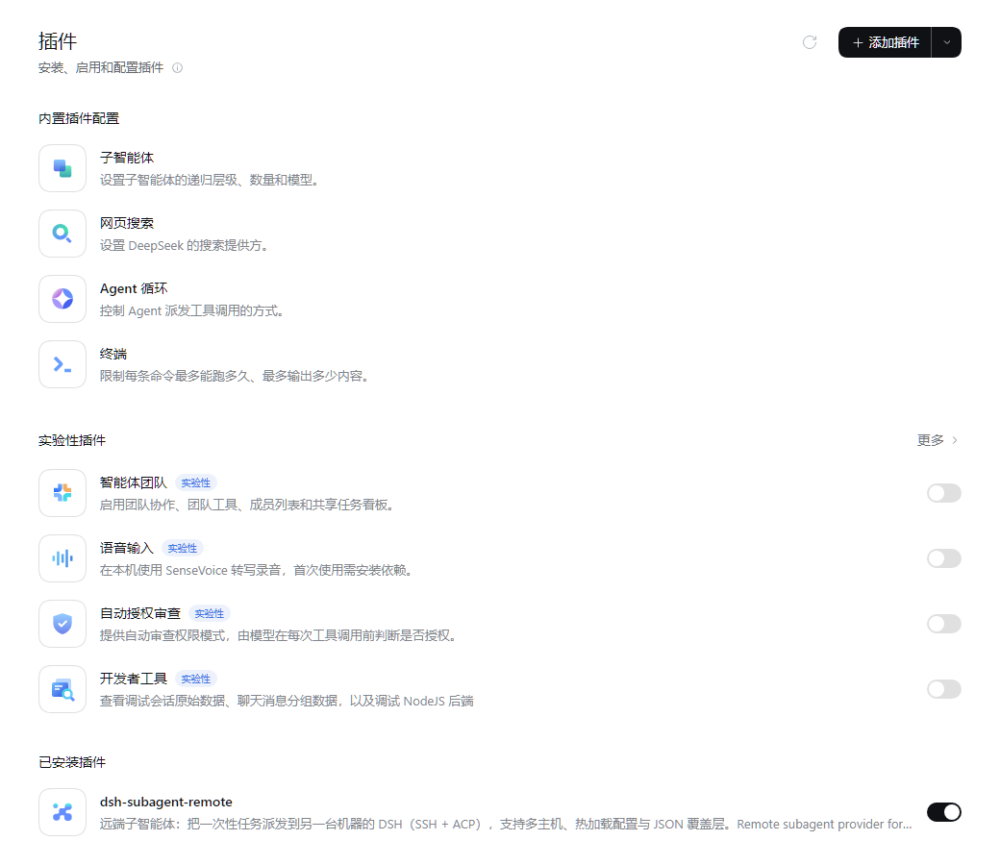
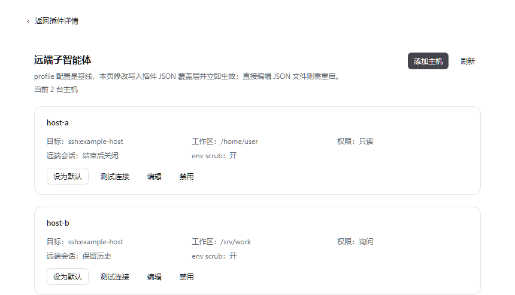
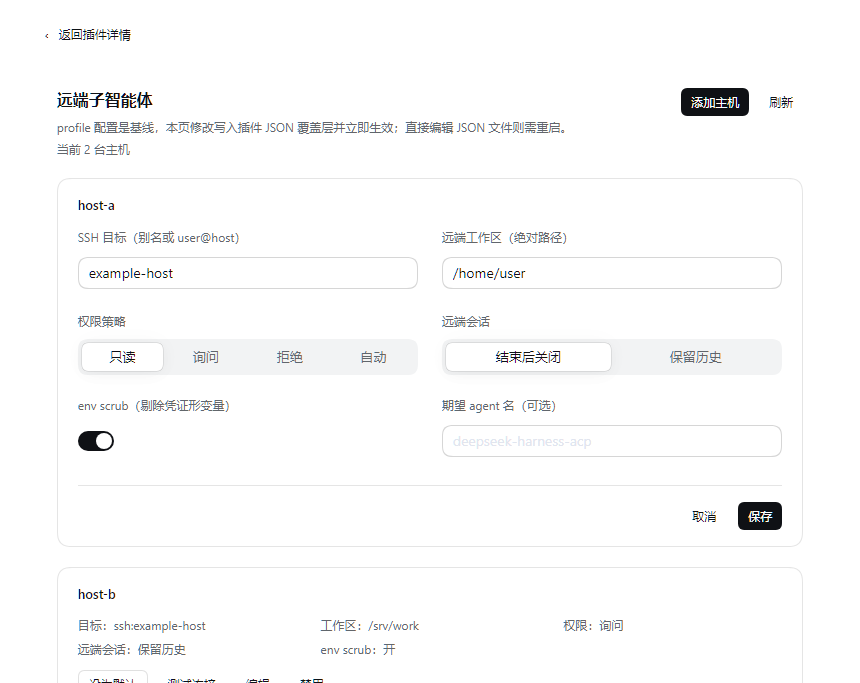

# dsh-subagent-remote 中文说明

跨机器（远端）子智能体 provider：本地 DSH 会话把**一次性**子任务派发到另一台机器上的
DSH `acp` profile 执行（SSH + ACP over stdio），再把远端 agent 的 closing message 返回
本地父会话。


> 状态：`0.9.2-rc.4`（候选版），已在 DSH `0.2.1-rc.2` 上验证（Windows 桌面 →
> 一台 Linux 主机、一台 macOS 主机、以及本地 `acp` profile）。**尚未发布到 npm**。
> English README: [README.md](README.md)

## 截图

| 插件页（已安装） | 配置页 | 主机编辑 |
|---|---|---|
|  |  |  |

## 定位（与官方远程/移动端规划的区别）

官方的「远程与移动端」是**从别的设备访问同一个 DSH 会话**；本插件解决的是
**跨机算力委派**：父会话留在本机，另一台机器用它自己的 DSH 运行时（工具、工作区、
模型、SSH 目标）执行一次性任务，只把 closing message 带回父会话；父会话不迁移、
不通过本插件对外暴露。

## 安装

**桌面/Web（官方插件页，推荐）**：**插件 → 添加插件**，输入 npm 包名
`dsh-subagent-remote` 确认；安装后出现在 **已安装插件**，点 **打开配置**。

CLI 方式（指定 profile）：

```powershell
dsh plugin --profile <profile> add dsh-subagent-remote
# 本地 checkout 开发
dsh plugin --profile <profile> add "link:C:\path\to\dsh-subagent-remote"
```

兼容性：`0.9.2-rc.4` 已在 DSH `0.2.1-rc.3` / `0.2.1-rc.2` 验证。

装好后启动 profile：`dsh <profile> --port <端口> --no-open`，在 Web/桌面端
**插件 → 已安装插件 → dsh-subagent-remote → 打开配置** 里添加主机。

## 使用

- 模型工具 `remote_subagent`：`host` 可省略（使用会话选择/默认主机）；
- 会话内切换：`/remote-host`（列出）、`/remote-host mac`（切换）、`/remote-host reset`
  （清除）。

主机配置写入插件自己的 JSON overlay（`$DSH_HOME/subagent-remote.json`），
profile patch 是基线；页面内修改热加载生效，直接改 JSON 文件需重启。

常用主机字段：

| 字段 | 说明 |
|---|---|
| `name` / `provider` | 主机名与 provider 名（默认 `remote-<name>`） |
| `ssh` / `cwd` | SSH 目标（别名或 user@host）与远端工作区绝对路径 |
| `permission` | `read-only` / `ask` / `deny` / `auto` |
| `remoteSession` | `close`（结束前调 ACP `session/close`）或 `keep` |
| `scrubEnv` | 是否剔除凭证形环境变量（SSH 默认开） |
| `timeoutMs` | 单次远端任务超时（默认 10 分钟） |

完整字段与诊断说明见 [README.md](README.md)。

## 安全

- 远端机器是被信任的（会运行 DSH 及其工具）；只配置你控制的主机；
- 插件不内置任何主机/账号/密钥，SSH 凭据走本机 `ssh` 配置；
- 无遥测。详见 [SECURITY.md](SECURITY.md)。

## 开发与测试

```powershell
npm run check   # 全部源码 node --check
npm test        # 5 个零依赖 selftest（policy/tool/config/settings/transport，约 315 项）
```

设置页验收脚本在 `test/playwright/`（需要本机 Playwright 与一个运行中的 DSH Web 实例）。

## 许可证

MIT，见 [LICENSE](LICENSE)。
